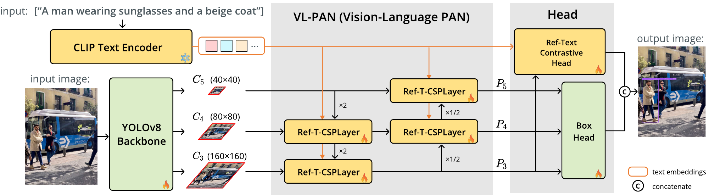
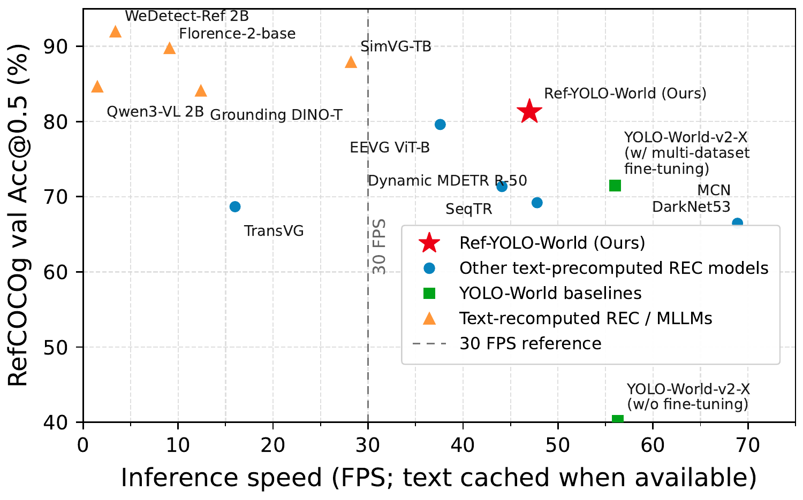
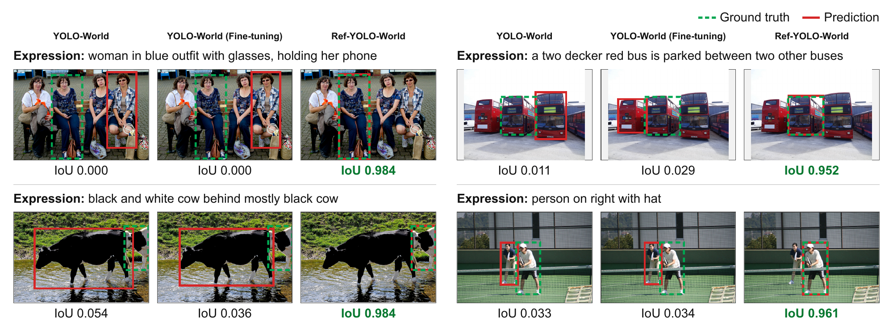

<div align="center">

# Ref-YOLO-World

**Decoupling Text-Side Computation for Efficient Referring Expression Comprehension on Edge Devices**

[](https://huggingface.co/sakusaku3939/Ref-YOLO-World)
[](LICENSE)

</div>

**Ref-YOLO-World** is an efficient referring expression comprehension (REC) model
for edge devices. It brings object detection from full sentences such as *"a man
wearing sunglasses and a beige coat"*, not just category names like *"person"*, to
small devices with limited compute such as smartphones. Built on the open-vocabulary
object detector [YOLO-World](https://github.com/AILab-CVC/YOLO-World), it uses
per-token text features while keeping text processing precomputable, so each
expression is encoded only once. It achieves 81.29% Acc@0.5 on RefCOCOg val and
runs at 15.73 FPS on an iPhone 15 Pro.

## 🔥 News

- `[2026-11-01]` We released the code and model weights of Ref-YOLO-World.

## 💡 Overview

<div align="center">

</div>

Ref-YOLO-World keeps its text branch independent of the image. All text-side
computation, including the key/value projections of the cross-attention, runs
once per expression and is cached, so each frame only runs a one-stage
detector. Per-token text features enter the detection path through two
lightweight modules:

- **Ref-T-CSPLayer** guides each neck stage with all token features through
  cross-attention, together with a 2-D positional encoding for spatial words.
- **Ref-Text Contrastive Head** adds the context of all tokens to each region
  feature before the region–text score.

<div align="center">


<br>
<sub>Left: accuracy and GPU inference speed on RefCOCOg val. Right: predictions compared with YOLO-World.</sub>
</div>

## 🛠️ Getting started

1. [Installation](docs/installation.md)
2. [Dataset preparation](docs/data.md)
3. [Training and evaluation](docs/reproduce.md)

## 📦 Checkpoints

Download the checkpoints into `weights/`.

| Model | Config | Download |
| --- | --- | --- |
| Ref-YOLO-World | [config](configs/ref_yolo_world/ref_yolo_world_multidataset.py) | [🤗 Download link](https://huggingface.co/sakusaku3939/Ref-YOLO-World/resolve/main/ref_yolo_world_x_multidataset.pth) |
| YOLO-World v2-X (pretrained, for training) | – | [🤗 Download link](https://huggingface.co/wondervictor/YOLO-World/resolve/main/yolo_world_v2_x_obj365v1_goldg_cc3mlite_pretrain_1280ft-14996a36.pth) |

## 🚀 Demo

```bash
python3 demo/ref_demo.py \
  --config configs/ref_yolo_world/ref_yolo_world_multidataset.py \
  --checkpoint weights/ref_yolo_world_x_multidataset.pth \
  --image demo/sample_images/bus.jpg \
  --text "the person on the left"
```

## 📊 Evaluation

```bash
CUDA_VISIBLE_DEVICES=0,1 ./tools/dist_test.sh \
  configs/ref_yolo_world/ref_yolo_world_multidataset.py \
  weights/ref_yolo_world_x_multidataset.pth \
  2
```

Training, the other benchmarks, inference speed, and the ablations are described
in [docs/reproduce.md](docs/reproduce.md).

## Acknowledgement

This work builds on [YOLO-World](https://github.com/AILab-CVC/YOLO-World) and
[MMYOLO](https://github.com/open-mmlab/mmyolo), and is released under the same
[GPL-3.0 license](LICENSE).
